<p align="center">
  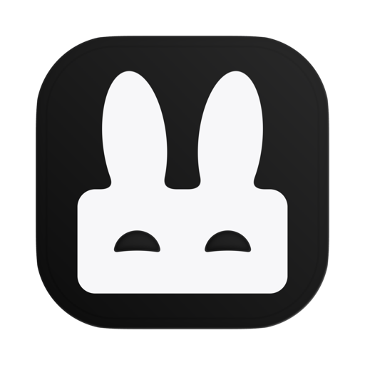
</p>

<h1 align="center">lisn</h1>

<p align="center">
  <strong>Say a thought. It files itself.</strong><br>
  A native notes app, written in Rust, for macOS and Windows.
</p>

<p align="center">
  <a href="https://github.com/slenderongithub/lisn-app/releases/latest"><b>Download</b></a>
  &nbsp;·&nbsp;
  <a href="#install">Install</a>
  &nbsp;·&nbsp;
  <a href="#features">Features</a>
  &nbsp;·&nbsp;
  <a href="#privacy">Privacy</a>
  &nbsp;·&nbsp;
  <a href="https://github.com/slenderongithub/lisn-app/releases/download/v0.1.0/lisn-film.mp4">Watch the film</a>
</p>

<br>

<p align="center">
  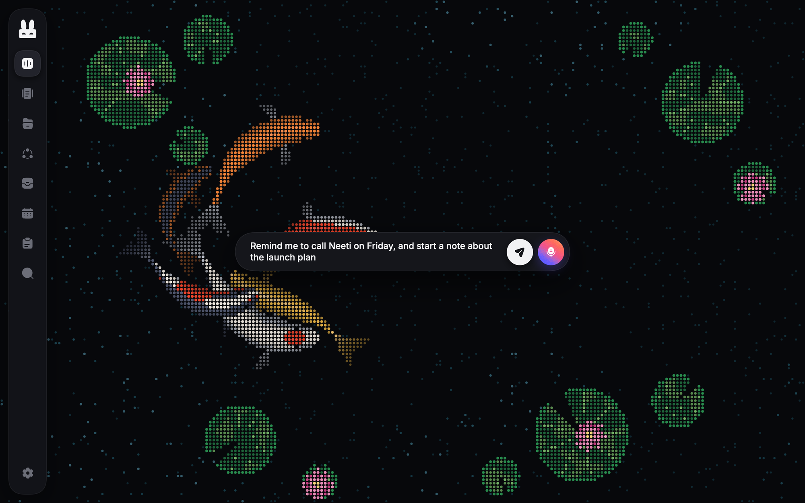
</p>

<br>

## What it is

lisn (said "listen") opens to an empty, living canvas. Speak or type whatever is on your mind. Your voice is turned into text on your own computer, and Claude files the thought into plain Markdown folders and notes for you: new projects, updated notes, reminders on the right day. Nothing to organise, nothing to lose, and every change can be undone in one step.

<p align="center">
  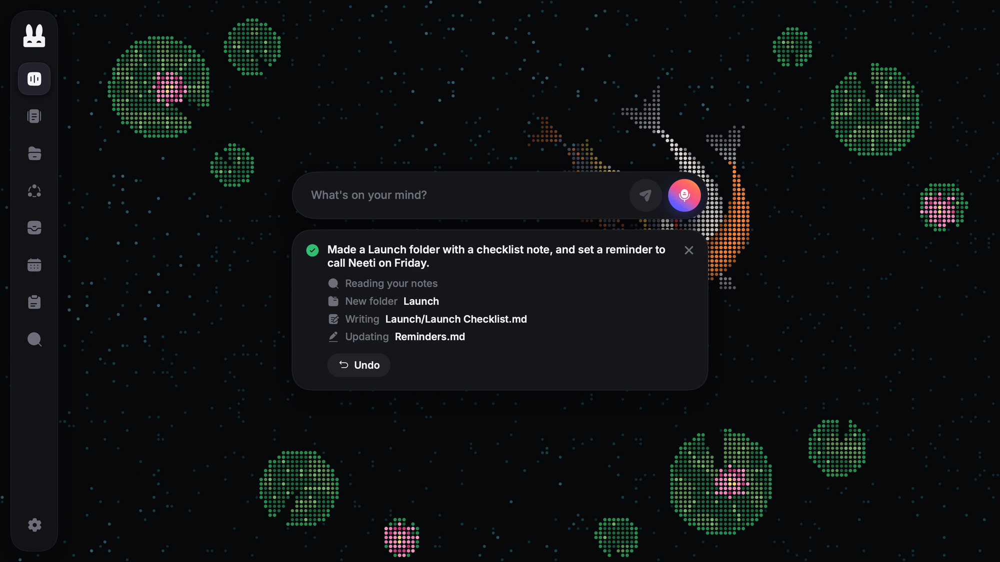
</p>

## Features

- **Speech-to-text that stays home.** NVIDIA Parakeet runs on your machine. Audio never leaves it and is never saved.
- **Your own Claude.** Filing runs through Claude Code with your Pro or Max plan. No API key, no account with us.
- **Plain Markdown.** Your notes are ordinary files in `Documents/LISN`. Open them in anything.
- **Undo anything.** Every change Claude makes is a step you can roll back, and every note keeps its history.
- **Made for your agents.** A read-only MCP server lets Claude Code and other agents read your notes. You choose which folders they see. They can never change anything.
- **A real editor.** Blocks for headings, to-dos, callouts, toggles, tables, code, pictures and files, with links between notes and tags.
- **See your thinking.** A graph of everything, a calendar of dots, a heatmap of your whole year, reminders and search.
- **Built to feel good.** GPU-drawn, with six living canvas scenes, springs on everything that moves, and calm sound.
- **A lock.** A password, and Touch ID on the Mac.

## Screens

<table>
  <tr>
    <td width="50%">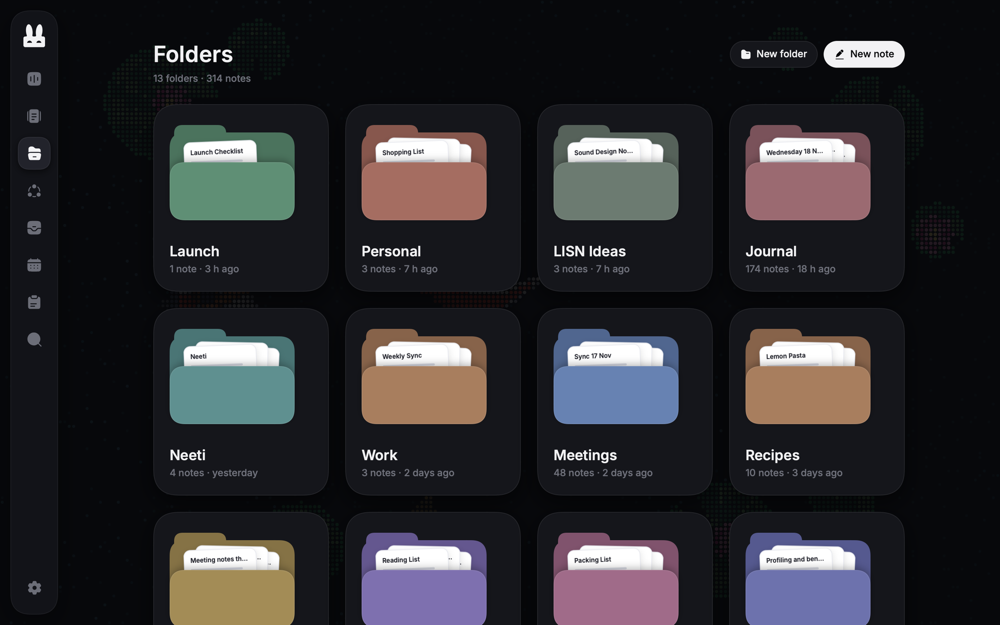<br><sub><b>Folders</b> that fan their notes open</sub></td>
    <td width="50%">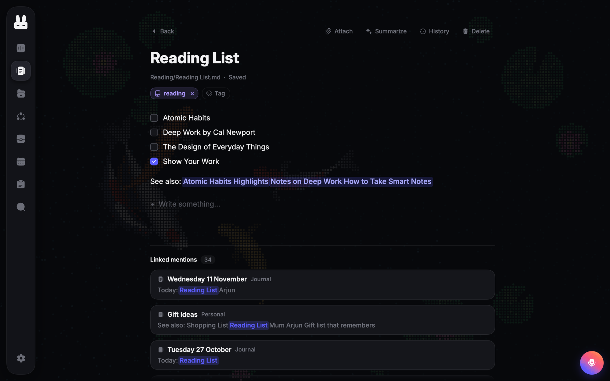<br><sub><b>Notes</b> in plain Markdown, with links back</sub></td>
  </tr>
  <tr>
    <td width="50%">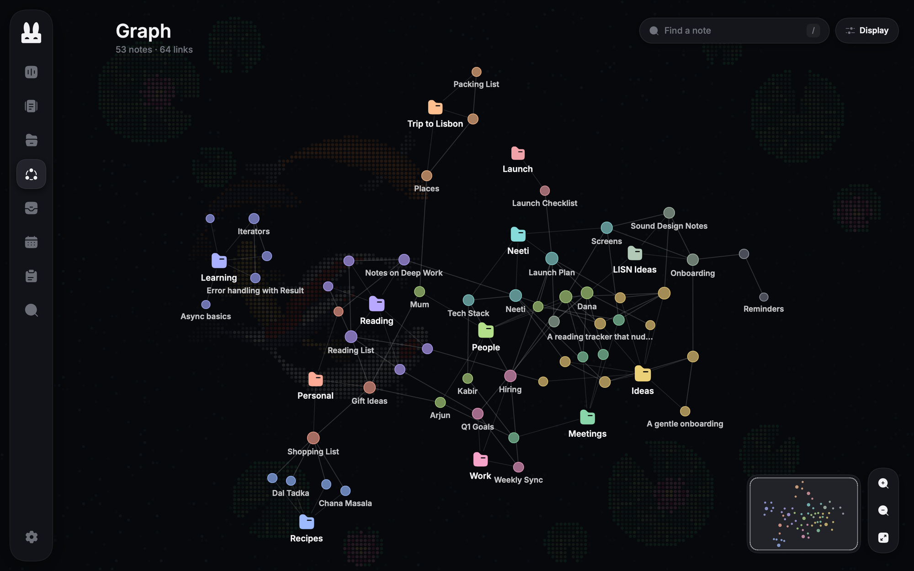<br><sub><b>Graph</b> of how everything connects</sub></td>
    <td width="50%">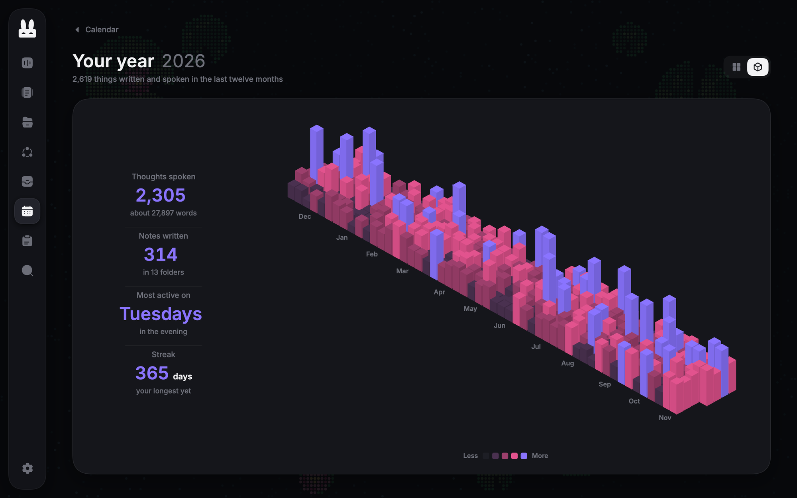<br><sub><b>Your year</b>, as a heatmap or a skyline</sub></td>
  </tr>
  <tr>
    <td width="50%">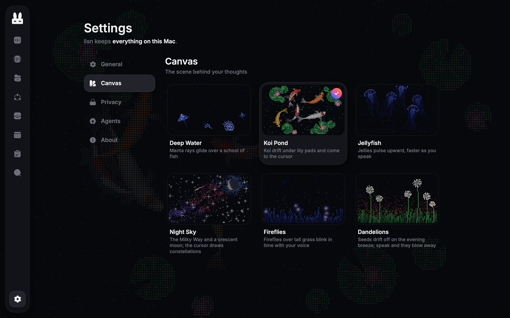<br><sub><b>Six scenes</b> behind your thoughts</sub></td>
    <td width="50%">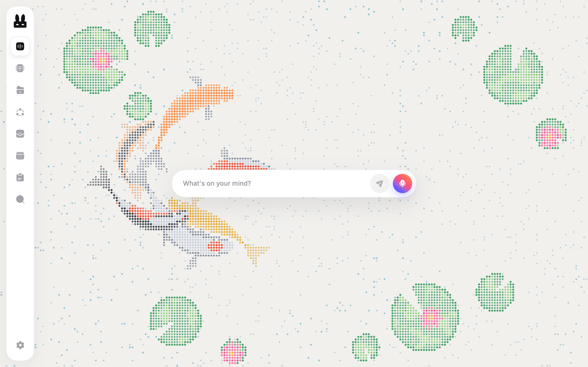<br><sub><b>Light and dark</b>, both made by hand</sub></td>
  </tr>
  <tr>
    <td width="50%">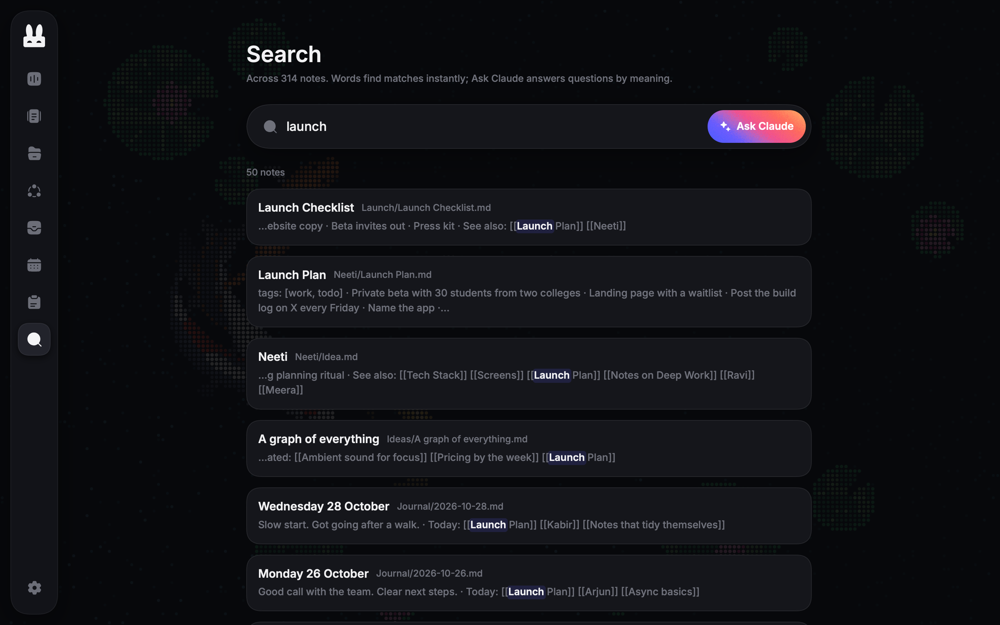<br><sub><b>Search</b> across every note</sub></td>
    <td width="50%">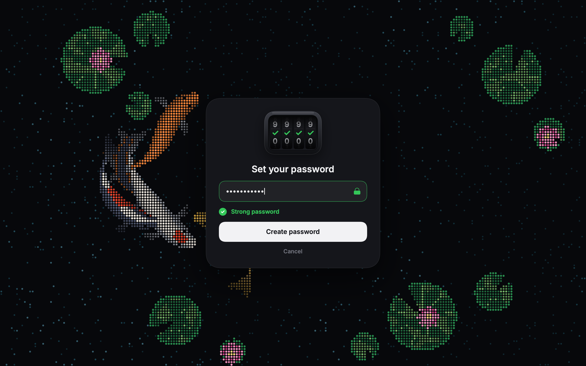<br><sub><b>The lock</b>, a combination dial that rolls to a tick per rule</sub></td>
  </tr>
</table>

<p align="center">
  <a href="https://github.com/slenderongithub/lisn-app/releases/download/v0.1.0/lisn-film.mp4">
    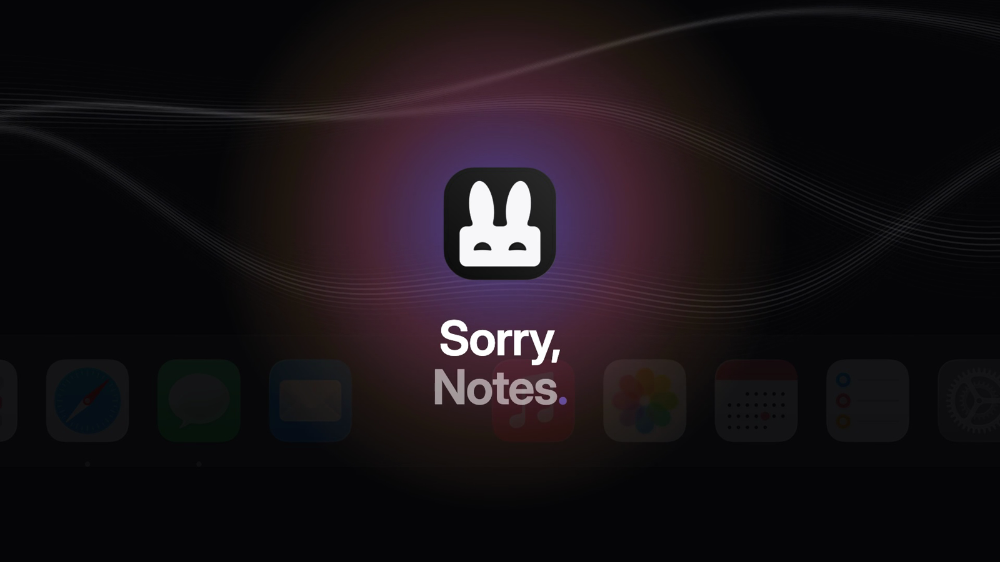
  </a>
  <br>
  <sub>Watch the film (1 min 43 s)</sub>
</p>

## Install

Get the files from the **[latest release](https://github.com/slenderongithub/lisn-app/releases/latest)**.

**macOS** (Apple Silicon, macOS 14 or later)

1. Open `lisn-0.1.0.dmg` and drag **lisn** onto **Applications**.
2. The first time, **right-click lisn → Open**, then **Open** again. The app isn't notarized yet, so macOS asks once. If it still refuses: System Settings → Privacy & Security → **Open Anyway**.
3. lisn offers to download its speech model (661 MB, once). Allow the microphone when asked.

**Windows** (10 or 11, 64-bit)

1. Unzip `lisn-0.1.0-windows.zip` anywhere and run `lisn.exe`. Keep `lisn-mcp.exe` and `DirectML.dll` beside it.
2. The exe isn't signed yet, so Windows SmartScreen warns once: **More info → Run anyway**.
3. lisn offers to download its speech model (661 MB, once). Allow the microphone when asked.

**You will also need** [Claude Code](https://claude.com/code), signed in with a Claude Pro or Max plan. Run `claude` once in a terminal and sign in. It is what files your thoughts.

**Shortcut:** `⌥⇧Space` on the Mac, `Alt+Shift+Space` on Windows, from any app, brings lisn forward and starts listening.

## How it works

1. **Say it.** Click the pill and speak, or just type. Parakeet turns your voice into text on your machine.
2. **Send it.** Claude reads your notes and files the thought: a new folder, an updated note, a reminder, a tidy summary.
3. **Check it.** You see each step it took. Undo any of it with one click.

## Under the hood

- **Rust, end to end.** One codebase for both platforms, with a thin native layer for each.
- **[Rune](https://github.com/anomalyco/rune)** for the interface: GPU-rendered, no web view, no Electron.
- **Local speech-to-text** with NVIDIA Parakeet TDT 0.6B, running on ONNX Runtime.
- **MCP** over stdio, so any agent can read your notes: one click connects Claude Code, and a copy-paste line covers the rest.
- **Plain files** for everything you write. lisn keeps its own history and transcripts in a hidden `.lisn` folder beside your notes.

<a id="privacy"></a>

## Privacy

- Your **voice** is transcribed on your computer and is never saved or sent anywhere.
- Your **notes** are plain Markdown files in `Documents/LISN`. They are not encrypted, and the lock screen is a privacy screen, not encryption: anything that can read your files can read your notes.
- To **file** a thought, Claude Code reads the notes it needs. It has no shell and no web access, and can only touch your notes folder.
- **Agents** connected through MCP get read-only access to the folders you choose. Switched-off folders and lisn's own data stay out of reach.
- The only things lisn downloads are its speech model, from one pinned address and checked against its checksum, and the page title and picture for links you paste.

## Checksums

```
f0732311954bfe3486b3ddd6354656d7b17f217866e9d3a4b8442f0415544261  lisn-0.1.0.dmg
1c0f8eae164085ada4631b2ac16141a8a7f6a8c065f27ae63248fb3e7ad81896  lisn-0.1.0-windows.zip
```

Check on a Mac with `shasum -a 256 lisn-0.1.0.dmg`, or on Windows with `certutil -hashfile lisn-0.1.0-windows.zip SHA256`.

## Status

This is an early release, **0.1**. The Mac build has had the most use. The Windows build is new, so please [open an issue](https://github.com/slenderongithub/lisn-app/issues) if anything misbehaves. Include `%APPDATA%\LISN\lisn.log` on Windows.

## Credits

lisn stands on work by others, used under their licenses.

| | |
|---|---|
| [Rune](https://github.com/anomalyco/rune) | UI framework (MIT) |
| [NVIDIA Parakeet TDT 0.6B v2](https://huggingface.co/nvidia/parakeet-tdt-0.6b-v2), ONNX export by istupakov | Speech-to-text (CC BY 4.0) |
| [parakeet-rs](https://github.com/altunenes/parakeet-rs) and [ONNX Runtime](https://onnxruntime.ai) | Runs the speech model (MIT, Apache 2.0) |
| [Inter](https://rsms.me/inter/) | Type (SIL OFL 1.1) |
| [Solar icons](https://www.figma.com/community/file/1166831539721848736) by 480 Design | Interface icons (CC BY 4.0) |

<br>

<p align="center">
  <sub>Made by <a href="https://github.com/slenderongithub">@slenderongithub</a>. lisn is free to download and use.</sub>
</p>
